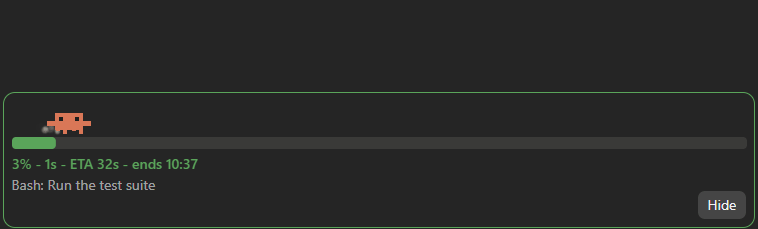
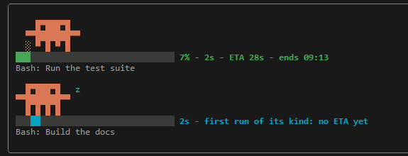

# live-progress

A Claude Code mod: a band above the prompt showing what is running right now (long tool calls, background builds and tests, subagents), each with a progress bar that fills by the job's learned typical duration (ETA).

#### In the desktop app



#### In the CLI



- In the desktop app, Clawd walks along an animated SVG bar, kicking up dust: he hops half way, the bar turns yellow near the usual end, and past it he goes red and sweats. A first run of its kind, with no ETA yet, has him dozing while a bar sweeps; when a job ends he jumps with confetti.
- In the CLI, the same Clawd in half-block characters (11 cells by 3 rows under a row of air for his hops, redrawn four times a second) does the same over a cell-laid bar with `% - elapsed - ETA - ends HH:MM`. With the `clawd` option off, the CLI draws only the bar and the job's label: two rows a job instead of six.
- The band's frame shows the most urgent job: green, yellow near the usual end, red past it, cyan while no job has an ETA.
- Up to four jobs show at once, the latest ones, with `+N more` for the rest (in the CLI, as many as fit the band's rows, without Clawd where not even one fits with him); a finished job stays 3 s with its `done in` time.
- Durations are learned per command kind (exponential average kept in the mod's store), so the second run of something gets an ETA. A kind is the script being run (by file name) or the program, with up to two subcommands (`manage.py migrate`, `npm run build`), plus the flags given, with their values when they name a mode or a place (`-Target web`, not `-OutName run7`). Each command of a chain counts, `cd`/`Set-Location` don't, and wrappers (`timeout`, `time`, `sudo`, `env`, `npx`, …) count by what they run: `./build.ps1 -Quick` and `./build.ps1 -Target web` learn apart, as do `npm ci` and `npm ci && npm run build`. Subagents learn by their type.
- Only runs that succeed teach a duration: a failed, refused or killed run is dropped from the band without changing the ETA, and a run that waited on a permission dialog teaches nothing (your time on the dialog is not the run's).
- Quick commands don't open the band: a job shows once it has run 2 s, or at once when its kind usually takes longer.
- Background tasks (`run_in_background`, or a command you move to the background with Ctrl+B) end on their notification. At each turn's end, a task the engine no longer lists as in flight is dropped without teaching a duration, once the list is empty or names another of the band's tasks (so a list that names tasks some other way never drops one still running); a main-loop call still on the band then is dropped too.
- Everything is drawn locally from engine events and a local clock: no model calls, no tokens.
- **Hide** closes the band until your next prompt (a turn started by a background notification or a schedule leaves it hidden).

Quick tools (`Read`, `Grep`, `Edit`, …), tools that wait on you (`AskUserQuestion`, `ExitPlanMode`, `EnterPlanMode`) and MCP tools are not shown.

## Install

No need to clone anything: Claude Code fetches the repository itself. At the prompt of a terminal Claude Code session, add this repository as a marketplace, then install the mod from it:

```
/plugin marketplace add jpabich/live-progress-claude-mod
```

```
/plugin install live-progress@live-progress-claude-mod
```

Pick a scope (user scope, so it loads in every session).

From a shell:

```bash
claude plugin marketplace add jpabich/live-progress-claude-mod
```

```bash
claude plugin install live-progress@live-progress-claude-mod
```

In the desktop app, where `/plugin` does not run: click **+** next to the prompt box, then **Plugins**, **Add marketplace** with `jpabich/live-progress-claude-mod`, then **Add plugin**.

The mod needs a Claude Code recent enough to load hooks modules (it was built on 2.1.314). An older one installs it without error but shows no band; run `claude update`, then restart the session.

### Options

| Option | Default | What it does |
| --- | --- | --- |
| `clawd` (Clawd in the terminal) | on | Off: the CLI band draws each job as its progress bar and label alone, two rows a job, so it takes less room and more jobs fit. The desktop app always draws Clawd. |

Set it in `/config` in a terminal session (the row **Clawd in the terminal** under live-progress), or on the options screen `/plugin install` shows.

## Develop

```bash
claude --plugin-dir /path/to/live-progress-claude-mod
```

Edits to `hooks/register.tsx` hot-reload. `tsconfig.json` extends `.claude-plugin/types/tsconfig.json`, which Claude Code writes the first time it loads the mod (it is git-ignored); after that, `tsc -p .` type-checks.

```bash
claude plugin validate .
```

```bash
claude plugin test .
```

## Layout

| Path | What |
| --- | --- |
| `.claude-plugin/plugin.json` | the mod's manifest |
| `.claude-plugin/marketplace.json` | makes this repository an installable marketplace |
| `hooks/hooks.json` | names the hooks module |
| `hooks/register.tsx` | the hooks: `tool.call`, `classic.PermissionRequest`, `session.append`, `classic.Stop`, `ui.render` (AbovePrompt), `prompt.submit`, `session.start`, `session.attach`, `session.detach` |
| `hooks/register.test.tsx` | the tests (`claude plugin test .`) |
| `types/index.d.ts` | the `$.state` contract (`jobs`, `now`, `isHidden`, `urgency`, `redraw`) |
| `assets/` | the demo GIFs |
